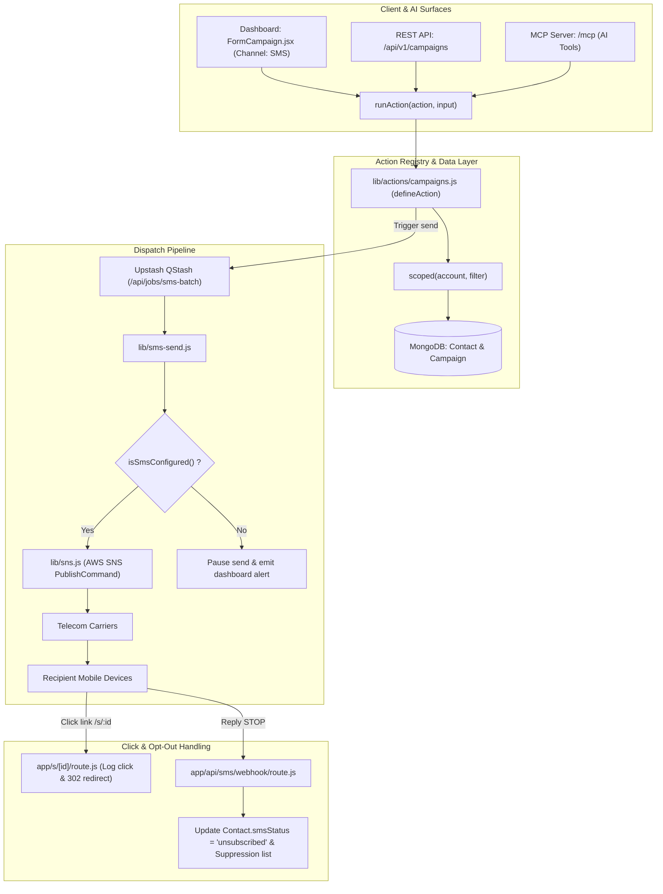

# SMS Channel Integration Specification for MailCheap

This specification describes the architecture, data models, queueing pipelines, and UI components required to introduce SMS campaigns into MailCheap as an upstream Pull Request to `marclou/mailcheap`.

## Overview

MailCheap is built on a clear value proposition: **pay only for what you send, never for dormant subscribers**. SMS is an exact continuation of this model: SMS pricing in the telecom industry is strictly pay-per-segment (160 characters).

Adding SMS provides creators and organizations with an immediate, high-engagement channel (95%+ open rates within 3 minutes) for urgent drops, live broadcast alerts, flash promotions, and critical notifications, directly complementing traditional newsletter emails.

---

## Architectural Principles

1. **Parity Between Self-Hosted and MailCheap Cloud**
   - **Self-Hosted (`!isCloud()`)**: Self-hosters supply their own AWS credentials via environment variables (`SNS_ACCESS_KEY_ID`, `SNS_SECRET_ACCESS_KEY`, `SNS_REGION`), with automatic fallback to existing `SES_*` credentials. There is no billing enforcement, and sending is unrestricted within their AWS quota.
   - **MailCheap Cloud (`isCloud()`)**: SMS sending is gated by server capability checks (`isSmsConfigured()`). If AWS credentials are not configured on the instance, the SMS channel option in the dashboard cleanly indicates that SMS is unavailable, without throwing runtime errors or disrupting email sending.

2. **Compliance with `AGENTS.md` and MailCheap Coding Conventions**
   - **JavaScript only**: Pure Node.js 22+ and Next.js 16 App Router. No TypeScript.
   - **Formatting**: Tab indentation. No full-file reformatting with external linters or Prettier.
   - **Action Unification (`defineAction`)**: Every customer action is registered in `lib/actions/` with Zod schemas. This ensures identical support across:
     - Dashboard Server Actions
     - Public REST API (`/api/v1`)
     - AI Agent MCP Server (`/mcp` and `lib/mcp/server.js`)
     - Generated OpenAPI specifications and `llms.txt`
     - Verification through `tests/parity.test.mjs`
   - **Multi-Tenant Safety**: Every database query must be wrapped in `scoped(account, filter)`.
   - **Tone and Copy**: Sentence case for all interface text ("Send SMS", "Review issue"). Display name is "MailCheap", machine names are lowercase (`mailcheap.ai`).
   - **No Emojis**: Code, comments, copy, and documentation avoid emojis entirely.

---

## Technical Architecture

---

## Implementation Roadmap

The implementation is broken down into 8 modular steps documented in this folder:

1. [01-aws-sns-setup.md](file:///c:/Users/louis/OneDrive/Desktop/Perso/mailcheap/docs/sms/01-aws-sns-setup.md): AWS SNS credential resolution, IAM permissions, and configuration checks.
2. [02-database-models.md](file:///c:/Users/louis/OneDrive/Desktop/Perso/mailcheap/docs/sms/02-database-models.md): MongoDB schema enhancements for `Contact`, `Campaign`, `Suppression`, and `CampaignLink`.
3. [03-actions-and-parity.md](file:///c:/Users/louis/OneDrive/Desktop/Perso/mailcheap/docs/sms/03-actions-and-parity.md): Action declarations via `defineAction` to satisfy `tests/parity.test.mjs`.
4. [04-queue-and-dispatch.md](file:///c:/Users/louis/OneDrive/Desktop/Perso/mailcheap/docs/sms/04-queue-and-dispatch.md): Batch processing, rate-limiting (MPS), and AWS SNS integration.
5. [05-link-shortener-and-tracking.md](file:///c:/Users/louis/OneDrive/Desktop/Perso/mailcheap/docs/sms/05-link-shortener-and-tracking.md): Built-in URL shortener (`/s/[id]`) and click attribution.
6. [06-compliance-and-stop-webhook.md](file:///c:/Users/louis/OneDrive/Desktop/Perso/mailcheap/docs/sms/06-compliance-and-stop-webhook.md): Automated opt-out handling ("STOP"), suppression persistence, and legal rules.
7. [07-ui-components-and-editor.md](file:///c:/Users/louis/OneDrive/Desktop/Perso/mailcheap/docs/sms/07-ui-components-and-editor.md): SMS composer, GSM-7 / UCS-2 segment calculator, and mobile phone preview mockup.
8. [08-help-center-and-tests.md](file:///c:/Users/louis/OneDrive/Desktop/Perso/mailcheap/docs/sms/08-help-center-and-tests.md): Help Center documentation (`lib/help.js`), test stubs, and regression verification.
